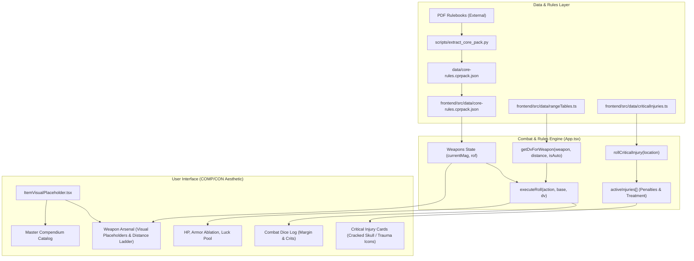

# CPR OMNI-DECK // System Architecture, Dependency Graph & Master Changelog

> **DOCUMENT PURPOSE**: This document serves as the single source of truth for the project's technical architecture, component dependency chains, and detailed version evolution. It is explicitly authored to be read and understood by human developers and future Large Language Models (LLMs such as Claude, ChatGPT, etc.) so that any future modification respects the underlying system mechanics without accidental regressions.

---

## 🤖 Instructions for Future AI Models (Claude, ChatGPT, etc.)
When tasked with modifying, refactoring, or extending this repository, **you must read and adhere to the following rules**:

1. **Architecture Decoupling (The COMP/CON Model)**:
   - Never hardcode rules or items into UI views directly.
   - Core static rules and book data reside in `data/` and `src/data/` as modular `.cprpack.json` files and typed TypeScript registry modules (`rangeTables.ts`, `criticalInjuries.ts`).
   - The UI in `src/App.tsx` and `src/components/` acts as a pure reactive consumer.
2. **System Dependencies & Cascade Effects**:
   - **Range & DV System (`src/data/rangeTables.ts`)**: If you alter distance brackets or weapon classifications, check `getDvForWeapon()` and `executeRoll()` in `App.tsx`. Do NOT change DV values without citing official Cyberpunk RED Core Rulebook (pg. 174).
   - **Weapons & Ammo (`src/App.tsx`)**: The attack trigger consumes ammo (`currentMag`). Autofire consumes 10 bullets. Ensure any weapon modification respects magazine bounds and reload states.
   - **Critical Injuries (`src/data/criticalInjuries.ts`)**: Uses exact 2d6 tables from Core Book (pg. 187-188). If adding new injury tables (e.g. Black Chrome vehicle crits), maintain the `CriticalInjury` interface.
   - **Visual Placeholders (`src/components/ItemVisualPlaceholder.tsx`)**: Every item rendered in combat or compendium must map cleanly to an item type placeholder to preserve the high-end tactile aesthetic.
3. **Always Update This Document**: Whenever you increment a version or modify system mechanics, document your changes in the **Master Version Changelog** below with: *What was changed*, *Files modified*, and *Potential regression areas*.

---

## 🗺️ System Architecture & Data Flow

```
cpr-omni-deck/
├── data/                                 # Raw extracted modular .cprpack JSON bundles
│   └── core-rules.cprpack.json           # Extracted Core Rulebook catalog
├── scripts/                              # Isolated Python extractors using pypdf
│   ├── extract_core_pack.py              # Ingests Core Rulebook PDF into JSON
│   └── find_sections.py                  # Bookmark and outline inspector
├── frontend/
│   ├── src/
│   │   ├── data/
│   │   │   ├── core-rules.cprpack.json   # Frontend active copy of core data
│   │   │   ├── rangeTables.ts            # Official Ranged & Autofire DV matrices
│   │   │   └── criticalInjuries.ts       # Official 2d6 Head & Body injury tables
│   │   ├── components/
│   │   │   └── ItemVisualPlaceholder.tsx # High-tech SVG/Lucide visual frames
│   │   ├── App.tsx                       # Unified Tactical Command Deck
│   │   ├── index.css                     # Chamfered corner styles & design tokens
│   │   └── main.tsx                      # Vite React entry point
│   ├── index.html                        # Google Fonts (Rajdhani, Inter, JetBrains Mono)
│   └── vite.config.ts                    # Vite config with Tailwind CSS v4
├── CHANGELOG_AND_ARCHITECTURE.md         # THIS DOCUMENT
└── CONTENT_CHECKLIST.md                  # Granular rulebook adaptation tracking
```

### Core Dependency Graph


---

## 📜 Master Version Changelog

### [v1.2.0] - 2026-10-15
* **Category**: Visual Hierarchy & Rule Mechanics Expansion
* **Files Modified**:
  - `frontend/src/components/ItemVisualPlaceholder.tsx` (CREATED)
  - `frontend/src/data/criticalInjuries.ts` (CREATED)
  - `frontend/src/App.tsx`
  - `CHANGELOG_AND_ARCHITECTURE.md` (CREATED)
  - `CONTENT_CHECKLIST.md` (CREATED)
* **What Changed**:
  1. Created `ItemVisualPlaceholder.tsx` featuring tactical military viewfinder frames (`chamfer-card` thumbnails) with category badges (`[HG]`, `[RF]`, `[SMG]`, `[SG]`, `[CQC]`, `[HVY]`, `[BODY]`, `[HEAD]`, `[CYBER]`, `[NET]`).
  2. Implemented the official Cyberpunk RED Critical Injuries tables (pg. 187-188) in `criticalInjuries.ts` for both Head and Body, including roll index (2-12), rule penalties, quick fixes, and clinic/hospital surgical treatments.
  3. Embedded an interactive Critical Injuries manager into the `Active Combat` deck with 1-click `[ + CRÍTICO CABEZA (2d6) ]` and `[ + CRÍTICO CUERPO (2d6) ]` rollers.
  4. Assigned dynamic trauma icons: cracked skull (`Skull`), brain trauma (`Brain`), eye trauma (`Eye`), broken bone (`Bone`), and chest puncture (`HeartCrack`).
  5. Added a `[ TRATAR / CURAR ]` button to instantly clear healed injuries.
  6. Connected visual placeholders across all weapons, armor, cyberware, and compendium catalog cards.
* **Potential Regression / Dependency Warnings**:
  - Active injuries display in the top command bar. If the injury ID format is altered, ensure `removeInjury(id)` filters properly.

---

### [v1.1.5] - 2026-10-15
* **Category**: Combat Mechanics & Range Engine
* **Files Modified**:
  - `frontend/src/data/rangeTables.ts` (CREATED)
  - `frontend/src/App.tsx`
* **What Changed**:
  1. Implemented the official Ranged Weapon Range Table from Core Rulebook (pg. 174).
  2. Defined 8 standard meter brackets: `0-6m`, `7-12m`, `13-25m`, `26-50m`, `51-100m`, `101-200m`, `201-400m`, `401-800m`.
  3. Added weapon range profiles for Pistol, SMG, Shotgun Slug, Assault Rifle, Sniper Rifle, Bows, Grenade Launcher, and Rocket Launcher.
  4. Added the official **Autofire Range Table** (SMG max multiplier 3, Assault Rifle max multiplier 4).
  5. Added an interactive Global Distance Selector and per-weapon Distance Ladders on each weapon card with a green `★ ÓPTIMO` highlight on the weapon's sweet spot.
  6. Added an Autofire mode toggle that expends 10 bullets and calculates `(Total - DV) * 2d6` damage multiplier.
* **Potential Regression / Dependency Warnings**:
  - Melee weapons do not use distance brackets; they bypass `rangeTables.ts` and roll against defender evasion DV. Do not enforce range brackets on `Melee` items.

---

### [v1.1.0] - 2026-10-15
* **Category**: Visual Styling & UX Overhaul
* **Files Modified**:
  - `frontend/index.html`
  - `frontend/src/index.css`
  - `frontend/src/App.tsx`
* **What Changed**:
  1. Replaced generic prototype styles with bespoke COMP/CON and Cyberpunk RED military aesthetic.
  2. Integrated Google Fonts: `Rajdhani` (tech/numbers/headers), `Inter` (readable UI body), and `JetBrains Mono` (code/stats).
  3. Added chamfered corner clipping (`clip-path: polygon(...)`) to all cards and buttons.
  4. Enforced universal `cursor: pointer` on all interactive elements with mechanical active press states (`active:scale-95 active:translate-y-[1px]`).
  5. Created an interactive magazine counter for ranged weapons with real-time bullet consumption and auto-switching `RELOAD MAG` button.
  6. Reorganized combat into clear vitals, armor ablation, weapon deck, and tactical dice log columns.

---

### [v1.0.0] - 2026-10-15
* **Category**: Project Scaffolding & Data Pipeline Foundation
* **Files Modified**:
  - `scripts/find_sections.py` (CREATED)
  - `scripts/extract_core_pack.py` (CREATED)
  - `data/core-rules.cprpack.json` (CREATED)
  - `Dockerfile`, `docker-compose.yml`, `start_app.bat`, `run_extractors.bat` (CREATED)
  - `frontend/` (Vite + React + TypeScript + Tailwind CSS initialized)
* **What Changed**:
  1. Built isolated sandbox in `C:\Users\TeseoHeracles\cpr-omni-deck` to avoid Windows Defender Controlled Folder Access restrictions.
  2. Setup isolated Python `.venv` with `pypdf`.
  3. Built initial PDF extractor targeting `Cyberpunk-RED-Core-Rulebook-v1.24_2020-12-25.pdf` and generated `core-rules.cprpack.json`.
  4. Initialized local Git repository with 5 structured commits.
