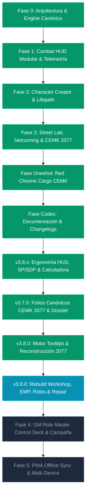

# CPR OMNI-DECK // Project Status & Master Development Roadmap

> **ESTADO DEL PROYECTO**: Versión Activa **`v3.9.0 OPERATIVO`**  
> **FECHA DE CORTE**: 2026-10-19  
> **ARQUITECTURA**: React 19 + TypeScript 5.8 + Vite + Tailwind CSS v4 + Zustand 5  
> **ALINEACIÓN**: Reglas oficiales Cyberpunk RED Core Rulebook + CEMK 2077 + Interface RED Vol. 1-4 + Danger Gal Dossier.

---

## 📊 1. Resumen Ejecutivo de Estado (v3.9.0)

CPR Omni-Deck es una plataforma táctica digital offline-first de alta fidelidad diseñada según la filosofía de arquitectura desacoplada COMP/CON de Lancer RPG. La aplicación actúa como un HUD de combate dinámico, un laboratorio de ciberware/equipo callejero, un asistente de Netrunning y un portal integral de gestión para Árbitros y Edgerunners de Cyberpunk RED.

### Métricas de Desarrollo en Vivo:
* **Ítems del Catálogo Multi-Libro**: 391+ ítems oficiales indexados sin pérdidas.
* **Folios Canónicos CEMK 2077**: 7 personajes oficiales pregenerados (28 páginas CEMK), 66 habilidades completas por folio con desglose `LVL + STAT = BASE`, y 7 tokens PNG oficiales.
* **Taller de Reconstrucción de Armas CEMK 2077**: Conversión 2045 a 2077 (Smart, Tech, Power) con toggles tácticos de combate (Bypass de Cobertura Smart, Rebote Power, Disparo Cargado Tech 50% SP).
* **Gestor de Averías & Pulso EMP de Ciberware**: Protocolo de resistencia ante EMP (`TECH + Cybertech + 1d10 vs DV 15`), selector de implantes con insignia `⚡ EMP OFF` y anulación dinámica de bonos.
* **Progresión de Rol Rango 1-10**: Visualizador de árbol de 10 rangos oficiales (`ROLE_ABILITIES_COMPLETE_PROGRESSION`) y selector rápido en Street Lab.
* **Motor de Descanso Natural & Reparación de Blindaje**: Recuperación de HP por días de reposo (reglas Core pp. 140, 222-223 con multiplicador de anticuerpos y criotanque) y matriz de reparación de SP de cabeza y torso según tabla de DVs de Tech.
* **Filtro de Decluttering del HUD**: Selector persistente (`cpr_combat_disabled_right_modules_v1`) y modo atenuado para silenciar módulos secundarios de la bandeja derecha.
* **Disciplinas Marciales Ergonómicas**: 27 artes marciales colapsables en formato compacto con fórmula estándar `Nombre • Stats • Fuente` (Core Rulebook + Interface RED Vol. 4).
* **Módulos de Sistema Principales**: 8 sistemas completamente integrados y operativos.
* **Enemigos y Facciones GM**: 44 perfiles base + 15 facciones oficiales (118 PNJs de Danger Gal Dossier).
* **Chasis e Implantes de Conversión Total (FBC)**: 13 cuerpos FBC y 16 ciberwares de cuerpo completo (*Going Metal*).
* **Módulos de Ergonomía Táctica**: Matriz de Blindaje SP/SDP, Calculadora Táctica de Daño en tiempo real y Workspace reconfigurable en 3, 4 o 5 columnas con arranque de centro despejado (`cpr_combat_active_center_v3`).

---

## 🛠️ 2. Módulos del Sistema Operativos (v3.9.0)

| # | Módulo | Componente Principal | Estado | Descripción Funcional |
|---|--------|----------------------|:------:|-----------------------|
| 1 | **Motor de Combate & HUD Táctico** | `CombatHudView.tsx` | **100% OPERATIVO** | Grid modular en 3 zonas, tiradas D10, selector de municiones (10 tipos), toggles tácticos 2077 (Smart bypass, Power ricochet, Tech charge shot), gestor de averías/EMP con tirada vs DV 15, reparación/descanso rápido y filtro de decluttering de bandeja derecha (`disabledRightModules`). |
| 2 | **Matriz Visual SP/SDP & Calculadora** | `CombatHudView.tsx` | **100% OPERATIVO** | Placas interactivas (`🛡️/💥`) para Cabeza y Torso, monitor SDP de Coberturas/Escudos (`🔰/💥`), Calculadora de Impactos con soporte para AP, Melee, Artes Marciales, Brawling y Críticos, y guía oficial integrada (pp. 183-187). |
| 3 | **Creador de Personajes & Lifepath** | `CharacterCreatorWizard.tsx` | **100% OPERATIVO** | Wizard de 6 pasos (Concepto/Rol, STATs por 3 métodos, Habilidades, Lifepath con tiradas 1d10, Equipo inicial por Rol y Exportación en formato oficial). |
| 4 | **Street Lab, Arsenal & Roles** | `StreetLabView.tsx` | **100% OPERATIVO** | Gestión de Eurodólares, Taller de Reconstrucción de Armas 2077, gestor de malfunciones/EMP en ciberware, pestañas dedicadas de Progresión de Rol Rango 1-10 y Descanso Natural/Reparación de Blindaje, 27 artes marciales colapsables y Dossier Canónico CEMK 2077. |
| 5 | **Netrunning & 10 Habilidades de Rol** | `NetAndRolesDeckView.tsx` | **100% OPERATIVO** | Simulador de arquitectura de Red 2045 con programas Black ICE, consola de Quickhacking CEMK 2077 con cola de memoria RAM, 27 artes marciales colapsables y terminal interactivo para las 10 Habilidades de Rol oficiales. |
| 6 | **Bestiario GM & Encuentros** | `EnemiesCompendiumPanel.tsx` | **100% OPERATIVO** | Catálogo de 44 enemigos base y 15 facciones con inyección directa de perfiles de combate en el HUD táctico y generador de goons al vuelo. |
| 7 | **Misión Oficial CEMK 2077 & Hub de Folios** | `RedChromeCargoView.tsx` | **100% OPERATIVO** | Misión interactiva *Red Chrome Cargo* con mapa Maglev Hammerhead, tablero de escenas, spawneo de enemigos, botín y pestaña 4 con selector dual de Edgerunners 2077 (7 Folios CEMK + 7 Anime Crew) con modal de 66 habilidades. |
| 8 | **Codex, Compendio & Documentación** | `SystemChangelogAndDocsView.tsx` / `CompendiumView.tsx` | **100% OPERATIVO** | Compendio con tooltips canónicos para subclases de armas, insignias de reconstrucción 2077, tooltips de munición y ciberware, portal in-app de documentación y registro cronológico (`v1.0.0` a `v3.9.0`). |

---

## 🗺️ 3. Estado Detallado del Roadmap por Fases

### ✅ Fase 0: Arquitectura Base, Ingesta CLI & Contratos Canónicos (COMPLETADA)
* **Objetivo**: Establecer la base de datos tipada sin inventar reglas, extrayendo los 272 ítems del Core Rulebook mediante Python.
* **Entregables**: Archivo `data/core-rules.cprpack.json`, scripts de extracción de PDFs, esquema JSON canónico y contratos TypeScript.

### ✅ Fase 1: Combat HUD Modular & Telemetría de Combate (COMPLETADA)
* **Objetivo**: Pantalla de combate para uso directo en mesa con resolución de ataques en 2 clics.
* **Entregables**: `CombatHudView.tsx`, cálculo automático de DVs según metros de distancia, soporte para Autofire (2d6 × multiplicador), consumo de munición, heridas críticas y consola de telemetría.

### ✅ Fase 2: Creador de Personajes Completo & Lifepath (COMPLETADA)
* **Objetivo**: Diseñar y generar edgerunners siguiendo las reglas canónicas del Core Rulebook.
* **Entregables**: `CharacterCreatorWizard.tsx`, 10 roles oficiales, 3 métodos de STATs (Streetrats, Edgerunners, Complete Package), Lifepath interactivo y compra de equipo inicial.

### ✅ Fase 3: Street Lab, Netrunning & Expansiones Interface RED (COMPLETADA)
* **Objetivo**: Integrar las expansiones premium oficiales de R. Talsorian Games.
* **Entregables**: `StreetLabView.tsx`, `NetAndRolesDeckView.tsx`, 23 artes marciales de *Interface RED Vol. 4*, 13 cuerpos FBC de *Going Metal*, Quickhacking del *Cyberpunk 2077 CEMK* y 118 PNJs de *Danger Gal Dossier*.

### ✅ Fase Oneshot: Misión Red Chrome Cargo (COMPLETADA)
* **Objetivo**: Implementar la aventura interactiva introductoria para el Árbitro.
* **Entregables**: `RedChromeCargoView.tsx`, mapa Maglev Hammerhead SVG con zoom/pan, tracker de vagones, notas de Árbitro y encuentro final con la banda Iron Sights.

### ✅ Fase Codex: Portal Maestro de Documentación & Changelog In-App (COMPLETADA)
* **Objetivo**: Visor interactivo dentro de la app para auditar todo el sistema.
* **Entregables**: `SystemChangelogAndDocsView.tsx`, timeline interactiva de versiones, inventario de sistemas y contrato de stack técnico.

### ✅ Actualización v3.6.0 - v3.6.2: Ergonomía Táctica del HUD de Combate (COMPLETADA)
* **Objetivo**: Proporcionar control total sobre el espacio visual de combate y automatizar el cálculo de blindaje y coberturas.
* **Entregables**:
  - **Selector de ancho de columna de Bio/Defensas**: Configuración de 3, 4 o 5 columnas (`cpr_left_panels_size_v1`) con reajuste reactivo de la columna central (el grid de Tailwind siempre totaliza 12).
  - **Controles de altura en tarjetas del panel izquierdo**: Modos `[ S ]` (160px), `[ M ]` (280px), `[ L ]` (480px), `[ ↕ Todo ]` y botones `[-]` / `[+]`.
  - **Grip de redimensionamiento vertical (`Resize Grip 📏`)**: Arrastre libre con ratón en la parte inferior de cada panel para ajuste fino de altura.
  - **Auto-expansión inteligente**: Detección automática cuando hay más de 3 heridas críticas, ciberware instalado o fármacos activos, expandiendo la tarjeta y mostrando la insignia `🔓 Auto-expandido ({count})`.
  - **Placas de Blindaje Visuales**: Insignias interactivas (`🛡️` intacta vs `💥` ablacionada) con click directo para fijar SP en Cabeza y Torso (hasta 20 placas).
  - **Monitor SDP de Escudos & Coberturas**: Rastreador de Puntos de Daño Estructural con presets oficiales (Escudo Antibalas 10 SDP, Madera 15 SDP, Metal 25 SDP, Acero 35 SDP).
  - **Calculadora Táctica de Daño en Tiempo Real**: Soporte completo para munición estándar (-1 SP), perforante AP (-2 SP), armas melee (50% SP), artes marciales (50% SP), brawling (100% SP) y daño directo (0% SP), cálculo de multiplicador de cabeza (×2) y críticos (+5 HP).
  - **Acordeón Oficial de Reglas CP RED**: Guía integrada con citas exactas del manual Core pp. 183-187.

### ✅ Actualización v3.8.0: Motor Táctico de Tooltips, Reconstrucción 2077 & Artes Marciales Colapsables (COMPLETADA)
* **Objetivo**: Integrar tooltips de reglas canónicas para armas, ciberware y municiones, soportar armas CEMK 2077 reconstruidas y compactar las 27 artes marciales en cartas colapsables.
* **Entregables**:
  - **Motor de Tooltips de Armas**: Subclases detectadas en vivo (Power, Tech, Smart, Exóticas, Melée pesada) con reglas de modo de disparo y mitigación de cobertura.
  - **Sistema de Reconstrucción CEMK 2077**: Insignias doradas y tooltips dedicados para armas 2077 reconstruidas sobre análogos 2045 (Malorian Arms 3516, Arasaka Tamayura, Budget Arms Carnage, Militech Crusher).
  - **Selector Rápido de Munición**: Barra de 10 tipos de munición canónica en Arsenal y HUD de combate con conmutador activo (`setWeaponAmmoType`) y tooltips de reglas/costes.
  - **Tooltips Anatómicos de Ciberware**: Categorías anatómicas (Neuroport, Neuralware, Cyberoptics, Cyberaudio, Cyberarm, Cyberleg, Internal, External, Borgware) con coste HL y nivel clínico.
  - **27 Artes Marciales Colapsables**: Cabeceras compactas `Nombre • Stats • Fuente` con acordeón interactivo en StreetLab, HUD de combate y Net & Roles Deck.
  - **Inicio de HUD Limpio**: Clave `cpr_combat_active_center_v3` por defecto vacía para un centro táctico despejado al arrancar sesión.

### ✅ Actualización v3.9.0: Taller de Reconstrucción CEMK 2077, Gestor de Averías/EMP, Progresión de Rol 1-10, Motor de Descanso/Reparación y Filtro de Decluttering del HUD (COMPLETADA)
* **Objetivo**: Implementar el taller de conversión balística 2077, soporte para pulso EMP y averías en ciberware, visualizador del árbol de progresión de los 10 roles, sistema de curación natural y reparación de armaduras, y filtro de reducción de ruido visual en combate.
* **Entregables**:
  - **Taller de Reconstrucción de Armas CEMK 2077**: Interfaz interactiva para convertir armas 2045 a variantes 2077 (Smart, Tech, Power) con coste en Eurodólares y persistencia en inventario.
  - **Toggles Tácticos de Combate 2077**: Controles directos en mano para Smart Cover Bypass (-4 a la evasión defensiva tras cobertura), Power Ricochet (-4 para disparos de rebote) y Tech Charge Shot (ignora 50% SP adicional).
  - **Gestor de Malfunciones & Pulso EMP**: Protocolo de resistencia ante EMP (`TECH + Cybertech + 1d10 vs DV 15`), selector individual con insignia `⚡ EMP OFF`, anulación de bonificaciones a estadísticas y botón de reinicio maestro.
  - **Pestaña de Progresión de Rol Rango 1-10**: Visualizador jerárquico de los 10 rangos de habilidad de rol (`ROLE_ABILITIES_COMPLETE_PROGRESSION`), resumen de reglas y selector interactivo con actualización en `StreetLabView.tsx`.
  - **Motor de Descanso Natural & Reparación de Blindaje**: Módulo de reposo por días (BODY/día, ×2 con Enhanced Antibodies, +BODY con Cryotank) y panel de reparación de SP de cabeza y torso basado en la tabla de DVs de Tech (Core pp. 140, 222-223).
  - **Filtro de Decluttering de Bandeja Derecha**: Conmutador de visibilidad (`disabledRightModules`) y modo atenuado en `CombatHudView.tsx` para silenciar módulos no utilizados.

### ⏳ Fase 4: GM Role Master Control Deck, Tracker de Iniciativa & Campaña (EN ROADMAP)
* **Objetivo**: Dotar al Árbitro de herramientas para coordinar iniciativas grupales, arbitraje de las 10 Habilidades de Rol, seguimiento de campaña y estado del equipo.
* **Módulos proyectados**:
  - **GM Role Master Control Deck**: Consola centralizada para arbitrar las 10 Habilidades de Rol oficiales:
    - *Solo (Combat Awareness)*: Detección y priorización táctica de amenazas.
    - *Netrunner (Interface)*: Topología de red, niveles de alerta y combate contra Black ICE.
    - *Tech (Maker)*: Cronómetros de fabricación, invención y mejoras de campo con DVs oficiales.
    - *Medtech (Medicine)*: Lotes farmacéuticos activos y terapia de trauma/adicción.
    - *Media (Credibility)*: Publicación de noticias, rumores y clúes de investigación.
    - *Exec (Teamwork)*: Gestión de nómina, lealtad y despliegue de personal corporativo.
    - *Lawman (Backup)*: Tiempos de respuesta de refuerzos y DVs de llamada policial.
    - *Fixer (Operator)*: Acceso a mercados negros, regateo y red de contactos.
    - *Nomad (Moto)*: Garaje de convoy, mejoras vehiculares y apoyo del clan.
    - *Rockerboy (Charismatic Impact)*: Control de público, locales y favores de fans.
  - **Tracker de Iniciativa Multi-Participante**: Turnos fluidos sincronizados con los 44 enemigos base y los 118 operativos de Danger Gal Dossier.
  - **Generador de Encuentros & Clima Urbano**: Tablas de calor por distrito de Night City y condiciones ambientales peligrosas.
  - **Gestor de Economía y Campaña**: Registro de deudas corporativas, alquiler mensual y estilo de vida (Core pg. 377).

### ⏳ Fase 5: Modo PWA Offline Sync & Conexión Local Multi-Dispositivo (EN ROADMAP)
* **Objetivo**: Permitir juego en mesa con múltiples dispositivos sincronizados localmente vía WebRTC/WebSockets sin requerir conexión a internet.
* **Módulos proyectados**:
  - Service Worker PWA con almacenamiento cacheado de todos los recursos gráficos y JSONs canónicos.
  - Sala local peer-to-peer para que el GM reciba las tiradas del jugador en tiempo real en su pantalla.
  - Exportación e importación de estado completo de partida en archivo `.cprsave.json`.

---

## 🔒 4. Matriz de Cumplimiento de Contratos Técnicos

* **Cero Desviación de Reglas**: Todas las mecánicas (DVs, tablas de rango, ablación, críticos, STATs) replican estrictamente los manuales impresos de R. Talsorian Games.
* **Arquitectura Offline-First**: Toda la información y estados se persisten en `localStorage` del navegador y en los catálogos JSON/TS empaquetados en el bundle, permitiendo ejecución en búnker sin conexión.
* **Integridad del Bundle**: 0 errores de TypeScript (`tsc -b --noEmit`) y 0 advertencias críticas en el empaquetado de producción (`npm run build`).
