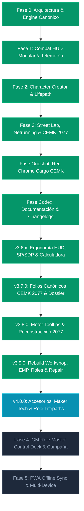

# CPR OMNI-DECK // Project Status & Master Development Roadmap

> **ESTADO DEL PROYECTO**: Versión Activa **`v4.1.0 OPERATIVO`**  
> **FECHA DE CORTE**: [Claude Code · 2026-10-20]  
> **PLAN ACTIVO**: `docs/plans/plan1-auditoria-core.md` (arreglos de la auditoría general, fases 1 y 2 de 5 hechas)  
> **ARQUITECTURA**: React 19 + TypeScript 5.8 + Vite + Tailwind CSS v4 + Zustand 5  
> **ALINEACIÓN**: Reglas oficiales Cyberpunk RED Core Rulebook + CEMK 2077 + Interface RED Vol. 1-4 + Danger Gal Dossier.

---

## 📊 1. Resumen Ejecutivo de Estado (v4.0.2)

CPR Omni-Deck es una plataforma táctica digital offline-first de alta fidelidad diseñada según la filosofía de arquitectura desacoplada COMP/CON de Lancer RPG. La aplicación actúa como un HUD de combate dinámico, un laboratorio de ciberware/equipo callejero, un asistente de Netrunning y un portal integral de gestión para Árbitros y Edgerunners de Cyberpunk RED.

### Métricas de Desarrollo en Vivo:
* **Ítems del Catálogo Multi-Libro**: 391+ ítems oficiales indexados sin pérdidas.
* **Folios Canónicos CEMK 2077**: 7 personajes oficiales pregenerados (28 páginas CEMK), 66 habilidades completas por folio con desglose `LVL + STAT = BASE`, y 7 tokens PNG oficiales.
* **Quickhacking Canónico CEMK 2077 (Sin RAM)**: 11 Quickhacks oficiales de Cyberpunk Edgerunners Mission Kit (pp. 16-18, 26-28) con coste de 1 NET Action, desbloqueo en Interface 1/2/3/4, bypass automático de Firewall DV 6 a Interface 3+ y flujo interactivo de 4 pasos (Jack In vs WILL, Breach Passwalls, Ejecutar Quickhack y Expulsión).
* **Calculadora de Daño e Impactos Ergonómica**: Entrada numérica libre (0-200) con ajuste fino -1/+1 y cálculo instantáneo de ablación SP y daño directo a HP.
* **Cabeceras HUD de Dos Filas**: Tarjetas modulares colapsables con fila 1 para arrastre/título/acciones rápidas y fila 2 para sub-barra de espacio S/M/L/Todo, garantizando cero solapamiento visual en 3 columnas.
* **Catálogo Canónico de Accesorios de Armas**: 23 aditamentos oficiales indexados con ranuras requeridas (0 a 3), costes y restricciones de categoría de arma.
* **Sistema Maker de Mejoras Tech**: Extra slot de accesorios, +1 SP de armadura (Cabeza y Torso), bonificaciones de calidad/daño/ROF con matriz de DVs y tiempos de fabricación oficiales (Core pp. 147-148).
* **Lifepaths Específicos de Rol**: 10 trasfondos oficiales de rol (Rockero, Solo, Netrunner, Tech, Medtech, Media, Ley, Ejecutivo, Fixer, Nómada) con tiradas 1d10 o selección directa.
* **Taller de Reconstrucción de Armas CEMK 2077**: Conversión 2045 a 2077 (Smart, Tech, Power) con toggles tácticos de combate (Bypass de Cobertura Smart, Rebote Power, Disparo Cargado Tech 50% SP).
* **Gestor de Averías & Pulso EMP de Ciberware**: Protocolo de resistencia ante EMP (`TECH + Cybertech + 1d10 vs DV 15`), selector de implantes con insignia `⚡ EMP OFF` y anulación dinámica de bonos.
* **Progresión de Rol Rango 1-10**: Visualizador de árbol de 10 rangos oficiales (`ROLE_ABILITIES_COMPLETE_PROGRESSION`) y selector rápido en Street Lab.
* **Motor de Descanso Natural & Asistencia Médica Canónica**: Recuperación de HP por días de reposo (Core pp. 140, 222-226), Anticuerpos Mejorados (2x/3x BODY HP), Criotanque (100 eb estancia, 50 eb químicos Medtech), Criobomba (congelación de salvadas de muerte) y Speedheal inyectable instantáneo.
* **Filtro de Decluttering del HUD**: Selector persistente (`cpr_combat_disabled_right_modules_v1`) y modo atenuado para silenciar módulos secundarios de la bandeja derecha.
* **Disciplinas Marciales Ergonómicas**: 27 artes marciales colapsables en formato compacto con fórmula estándar `Nombre • Stats • Fuente` (Core Rulebook + Interface RED Vol. 4).
* **Módulos de Sistema Principales**: 8 sistemas completamente integrados y operativos.
* **Enemigos y Facciones GM**: 44 perfiles base + 15 facciones oficiales (118 PNJs de Danger Gal Dossier).
* **Chasis e Implantes de Conversión Total (FBC)**: 13 cuerpos FBC y 16 ciberwares de cuerpo completo (*Going Metal*).
* **Módulos de Ergonomía Táctica**: Matriz de Blindaje SP/SDP, Calculadora Táctica de Daño en tiempo real y Workspace reconfigurable en 3, 4 o 5 columnas con arranque de centro despejado (`cpr_combat_active_center_v3`).

---

## 🛠️ 2. Módulos del Sistema Operativos (v4.0.2)

| # | Módulo | Componente Principal | Estado | Descripción Funcional |
|---|--------|----------------------|:------:|-----------------------|
| 1 | **Motor de Combate & HUD Táctico** | `CombatHudView.tsx` | **100% OPERATIVO** | Grid modular en 3 zonas, tiradas D10, selector de municiones (10 tipos), toggles tácticos 2077, gestor de averías/EMP con tirada vs DV 15, reparación/descanso rápido, cabeceras HUD estructuradas en 2 filas, calculadora de impactos libre (0-200) y consola CEMK de Quickhacking con flujo canónico de 4 pasos sin RAM. |
| 2 | **Matriz Visual SP/SDP & Calculadora** | `CombatHudView.tsx` | **100% OPERATIVO** | Placas interactivas (`🛡️/💥`) para Cabeza y Torso, monitor SDP de Coberturas/Escudos (`🔰/💥`), Calculadora de Impactos con input numérico (0-200), soporte para AP, Melee, Artes Marciales, Brawling y Críticos, y guía oficial integrada (pp. 183-187). |
| 3 | **Creador de Personajes & Lifepath** | `CharacterCreatorWizard.tsx` | **100% OPERATIVO** | Wizard de 6 pasos (Concepto/Rol, STATs por 3 métodos, Habilidades, Lifepath con tiradas 1d10, Equipo inicial por Rol y Exportación en formato oficial). |
| 4 | **Street Lab, Arsenal & Roles** | `StreetLabView.tsx` | **100% OPERATIVO** | Gestión de Eurodólares, Taller de Reconstrucción de Armas 2077, gestor de malfunciones/EMP en ciberware, pestañas de Progresión de Rol 1-10, Descanso/Asistencia Médica Canónica (Anticuerpos, Criotanque, Criobomba, Speedheal), Lifepaths de Rol, gestión e instalación de los 23 accesorios de armas con slots y mejoras Maker Tech (+1 Slot, +1 SP, daño, ROF). |
| 5 | **Netrunning & 10 Habilidades de Rol** | `NetAndRolesDeckView.tsx` | **100% OPERATIVO** | Simulador de arquitectura de Red 2045 con programas Black ICE, consola canónica CEMK 2077 de Quickhacking (11 hacks oficiales, Interface 1-4, flujo de 4 pasos, cero RAM), Modo Master (GM) para ocultar pisos a jugadores, 27 artes marciales colapsables y terminal interactivo para las 10 Habilidades de Rol oficiales. |
| 6 | **Bestiario GM & Encuentros** | `EnemiesCompendiumPanel.tsx` | **100% OPERATIVO** | Catálogo de 44 enemigos base y 15 facciones con inyección directa de perfiles de combate en el HUD táctico y generador de goons al vuelo. |
| 7 | **Misión Oficial CEMK 2077 & Hub de Folios** | `RedChromeCargoView.tsx` | **100% OPERATIVO** | Misión interactiva *Red Chrome Cargo* con mapa Maglev Hammerhead, tablero de escenas, spawneo de enemigos, botín, vulnerabilidades y modal con los 11 Quickhacks oficiales de CEMK a 1 NET Action. |
| 8 | **Codex, Compendio & Documentación** | `SystemChangelogAndDocsView.tsx` / `CompendiumView.tsx` | **100% OPERATIVO** | Compendio con tooltips canónicos para subclases de armas, insignias de reconstrucción 2077, tooltips de munición y ciberware, portal in-app de documentación y registro cronológico (`v1.0.0` a `v4.0.2`). |

---

## 🗺️ 3. Estado Detallado del Roadmap por Fases

### ✅ Fase 0: Arquitectura Base, Ingesta CLI & Contratos Canónicos (COMPLETADA)
* **Objetivo**: Establecer la base de datos tipada sin inventar reglas, extrayendo los 272 ítems del Core Rulebook mediante Python.
* **Entregables**: Archivo `data/core-rules.cprpack.json`, scripts de extracción de PDFs, esquema JSON canónico y contratos TypeScript.

### ✅ Fase 1: Combat HUD Modular & Telemetría de Combate (COMPLETADA)
* **Objetivo**: Pantalla de combate para uso directo en mesa con resolución de ataques en 2 clics.
* **Entregables**: `CombatHudView.tsx`, cálculo automático de DVs según metros de distancia, soporte para Autofire (2d6 × multiplicador), consumo de munición, heridas críticas y consola de telemetría.

### ✅ Fase 2: Creador de Personajes Completo & Lifepath (COMPLETADA)
* **Objetivo**: Diseñar y generar edgerunners siguiendo las reglas canónicas del Core Rulebook.
* **Entregables**: `CharacterCreatorWizard.tsx`, 10 roles oficiales, 3 métodos de STATs (Streetrats, Edgerunners, Complete Package), Lifepath interactivo y compra de equipo inicial.

### ✅ Fase 3: Street Lab, Netrunning & Expansiones Interface RED (COMPLETADA)
* **Objetivo**: Integrar las expansiones premium oficiales de R. Talsorian Games.
* **Entregables**: `StreetLabView.tsx`, `NetAndRolesDeckView.tsx`, 23 artes marciales de *Interface RED Vol. 4*, 13 cuerpos FBC de *Going Metal*, Quickhacking del *Cyberpunk 2077 CEMK* y 118 PNJs de *Danger Gal Dossier*.

### ✅ Fase Oneshot: Misión Red Chrome Cargo (COMPLETADA)
* **Objetivo**: Implementar la aventura interactiva introductoria para el Árbitro.
* **Entregables**: `RedChromeCargoView.tsx`, mapa Maglev Hammerhead SVG con zoom/pan, tracker de vagones, notas de Árbitro y encuentro final con la banda Iron Sights.

### ✅ Fase Codex: Portal Maestro de Documentación & Changelog In-App (COMPLETADA)
* **Objetivo**: Visor interactivo dentro de la app para auditar todo el sistema.
* **Entregables**: `SystemChangelogAndDocsView.tsx`, timeline interactiva de versiones, inventario de sistemas y contrato de stack técnico.

### ✅ Actualización v3.6.0 - v3.6.2: Ergonomía Táctica del HUD de Combate (COMPLETADA)
* **Objetivo**: Proporcionar control total sobre el espacio visual de combate y automatizar el cálculo de blindaje y coberturas.
* **Entregables**:
  - **Selector de ancho de columna de Bio/Defensas**: Configuración de 3, 4 o 5 columnas (`cpr_left_panels_size_v1`) con reajuste reactivo de la columna central (el grid de Tailwind siempre totaliza 12).
  - **Controles de altura en tarjetas del panel izquierdo**: Modos `[ S ]` (160px), `[ M ]` (280px), `[ L ]` (480px), `[ ↕ Todo ]` y botones `[-]` / `[+]`.
  - **Grip de redimensionamiento vertical (`Resize Grip 📏`)**: Arrastre libre con ratón en la parte inferior de cada panel para ajuste fino de altura.
  - **Auto-expansión inteligente**: Detección automática cuando hay más de 3 heridas críticas, ciberware instalado o fármacos activos, expandiendo la tarjeta y mostrando la insignia `🔓 Auto-expandido ({count})`.
  - **Placas de Blindaje Visuales**: Insignias interactivas (`🛡️` intacta vs `💥` ablacionada) con click directo para fijar SP en Cabeza y Torso (hasta 20 placas).
  - **Monitor SDP de Escudos & Coberturas**: Rastreador de Puntos de Daño Estructural con presets oficiales (Escudo Antibalas 10 SDP, Madera 15 SDP, Metal 25 SDP, Acero 35 SDP).
  - **Calculadora Táctica de Daño en Tiempo Real**: Soporte completo para munición estándar (-1 SP), perforante AP (-2 SP), armas melee (50% SP), artes marciales (50% SP), brawling (100% SP) y daño directo (0% SP), cálculo de multiplicador de cabeza (×2) y críticos (+5 HP).
  - **Acordeón Oficial de Reglas CP RED**: Guía integrada con citas exactas del manual Core pp. 183-187.

### ✅ Actualización v3.8.0: Motor Táctico de Tooltips, Reconstrucción 2077 & Artes Marciales Colapsables (COMPLETADA)
* **Objetivo**: Integrar tooltips de reglas canónicas para armas, ciberware y municiones, soportar armas CEMK 2077 reconstruidas y compactar las 27 artes marciales en cartas colapsables.
* **Entregables**:
  - **Motor de Tooltips de Armas**: Subclases detectadas en vivo (Power, Tech, Smart, Exóticas, Melée pesada) con reglas de modo de disparo y mitigación de cobertura.
  - **Sistema de Reconstrucción CEMK 2077**: Insignias doradas y tooltips dedicados para armas 2077 reconstruidas sobre análogos 2045 (Malorian Arms 3516, Arasaka Tamayura, Budget Arms Carnage, Militech Crusher).
  - **Selector Rápido de Munición**: Barra de 10 tipos de munición canónica en Arsenal y HUD de combate con conmutador activo (`setWeaponAmmoType`) y tooltips de reglas/costes.
  - **Tooltips Anatómicos de Ciberware**: Categorías anatómicas (Neuroport, Neuralware, Cyberoptics, Cyberaudio, Cyberarm, Cyberleg, Internal, External, Borgware) con coste HL y nivel clínico.
  - **27 Artes Marciales Colapsables**: Cabeceras compactas `Nombre • Stats • Fuente` con acordeón interactivo en StreetLab, HUD de combate y Net & Roles Deck.
  - **Inicio de HUD Limpio**: Clave `cpr_combat_active_center_v3` por defecto vacía para un centro táctico despejado al arrancar sesión.

### ✅ Actualización v3.9.0: Taller de Reconstrucción CEMK 2077, Gestor de Averías/EMP, Progresión de Rol 1-10, Motor de Descanso/Reparación y Filtro de Decluttering del HUD (COMPLETADA)
* **Objetivo**: Implementar el taller de conversión balística 2077, soporte para pulso EMP y averías en ciberware, visualizador del árbol de progresión de los 10 roles, sistema de curación natural y reparación de armaduras, y filtro de reducción de ruido visual en combate.
* **Entregables**:
  - **Taller de Reconstrucción de Armas CEMK 2077**: Interfaz interactiva para convertir armas 2045 a variantes 2077 (Smart, Tech, Power) con coste en Eurodólares y persistencia en inventario.
  - **Toggles Tácticos de Combate 2077**: Controles directos en mano para Smart Cover Bypass (-4 a la evasión defensiva tras cobertura), Power Ricochet (-4 para disparos de rebote) y Tech Charge Shot (ignora 50% SP adicional).
  - **Gestor de Malfunciones & Pulso EMP**: Protocolo de resistencia ante EMP (`TECH + Cybertech + 1d10 vs DV 15`), selector individual con insignia `⚡ EMP OFF`, anulación de bonificaciones a estadísticas y botón de reinicio maestro.
  - **Pestaña de Progresión de Rol Rango 1-10**: Visualizador jerárquico de los 10 rangos de habilidad de rol (`ROLE_ABILITIES_COMPLETE_PROGRESSION`), resumen de reglas y selector interactivo con actualización en `StreetLabView.tsx`.
  - **Motor de Descanso Natural & Reparación de Blindaje**: Módulo de reposo por días (BODY/día, ×2 con Enhanced Antibodies, +BODY con Cryotank) y panel de reparación de SP de cabeza y torso basado en la tabla de DVs de Tech (Core pp. 140, 222-223).
  - **Filtro de Decluttering de Bandeja Derecha**: Conmutador de visibilidad (`disabledRightModules`) y modo atenuado en `CombatHudView.tsx` para silenciar módulos no utilizados.

### ✅ Actualización v4.0.0: Catálogo de Accesorios de Armas, Sistema Maker de Mejoras Tech & Lifepaths Específicos de Rol (COMPLETADA)
* **Objetivo**: Implementar el catálogo canónico de 23 accesorios de armas con ranuras y requerimientos, soporte para disparos secundarios en combate, mejoras oficiales de la habilidad de rol Maker para armas y armaduras, y trasfondos de Lifepath específicos para los 10 roles del Core Rulebook.
* **Entregables**:
  - **Catálogo Canónico de 23 Accesorios de Armas**: Definido en `weaponAttachmentsAndTechData.ts` (`WEAPON_ATTACHMENTS_CATALOG`) con cálculo estricto de capacidad de ranuras (Core p. 342: Mala Calidad 1, Estándar 2, Excelente Calidad 3) y soporte para armas exóticas (0 ranuras por defecto).
  - **Gestor de Instalación y Desinstalación**: Integrado tanto en `StreetLabView.tsx` (pestaña Arsenal) como en `CombatHudView.tsx` (En Mano y Cinturón de Arsenal), permitiendo desinstalar aditamentos y recuperar slots libres.
  - **Disparos Secundarios en HUD de Combate**: Botones de acción directa con tirada de ataque y daño parametrizado para:
    - *Bayoneta*: Ataque melée 1d6 (ROF 2) sin cambiar de arma.
    - *Escopeta Bajo Cañón*: Disparo 3d6 (Shell) con tabla de dispersión de escopeta.
    - *Lanzagranadas Bajo Cañón*: Disparo de proyectil explosivo 6d6 (Grenade) con tabla de DV de explosivos.
  - **Modificadores Balísticos Activos**: Integración de bonos en el motor balístico para Smartgun Link (+1/+2 check de puntería), Teleobjetivo/Infrarrojo/Visor Nocturno (anulación de penalizadores de distancia y oscuridad), Linterna Táctica y Tambor de Munición ampliado.
  - **Sistema Maker de Mejoras Tech**: Implementación canónica de las opciones de mejora de campo (Core pp. 147-148):
    - *Armas*: Ranura de accesorio extra (+1 slot), mejora de calidad (Mala a Estándar, Estándar a Excelente), mejora de daño de combate (+1 dmg o +1d6 según caso) y aumento de cadencia de fuego (ROF).
    - *Armaduras*: Mejora de blindaje (+1 SP en Cabeza y +1 SP en Torso) con toggle interactivo y persistencia en estado.
    - *Matriz de Fabricación Maker*: Cálculo en vivo de DVs y tiempos de fabricación reglamentarios según coste del ítem (100 eb DV 13 / 1 día, 500 eb DV 17 / 1 semana, 1.000 eb DV 21 / 2 semanas, etc.).
  - **Lifepaths Específicos de Rol**: 10 conjuntos de tablas canónicas de trasfondo (Core pp. 44-71) para Rockerboy, Solo, Netrunner, Tech, Medtech, Media, Lawman, Exec, Fixer y Nomad con generador de tiradas 1d10 o selección manual en Street Lab.

### ✅ Actualización v4.0.1: Ergonomía de STATS, Asistencia Médica Canónica, Modo Master en Netrunning & Acciones de Interfaz (COMPLETADA)
* **Objetivo**: Corregir problemas de visualización en tooltips de estadísticas, implementar la guía médica y descanso exhaustivo (Enhanced Antibodies, Cryotank, Cryopump, Speedheal), dotar al Netrunning de un Modo Master (GM) que oculte por defecto las 9 arquitecturas preconstruidas a los jugadores, detallar exhaustivamente las 9 Acciones de Interfaz con resolución de DVs canónica y resolver el bug de concatenación `DV 612`.
* **Entregables**:
  - **Corrección de Clipping en Tooltips de STATS (`StreetLabView.tsx`)**: Reemplazo de la clase `.chamfer-card` (cuyo `clip-path` recortaba los tooltips emergentes) por bordes redondeados y configuración `relative z-30 overflow-visible` tanto en el contenedor como en la grilla interna.
  - **Especificación Médica Exhaustiva & Descanso Canónico (`weaponAndCyberwareTooltips.ts`, `StreetLabView.tsx`, `CombatHudView.tsx`)**:
    - *Estabilización & Reposo Natural*: DVs 10, 13 y 15 para Estabilización según condición médica; regla de esfuerzo severo (0 HP recuperados si se realizan tareas extenuantes); curación base de 1x BODY HP por día de descanso completo.
    - *Anticuerpos Mejorados (Enhanced Antibodies)*: Coste 500 eb, 1 ranura interna, 2 HL (1d6), duplica la tasa de curación natural a 2x BODY HP/día (o 3x BODY HP/día combinado con Criotanque). Botón interactivo de compra e instalación rápida en Street Lab y Combat HUD.
    - *Criotanque (Cryotank)*: Coste 5.000 eb de compra, 30 SDP, servicio hospitalario a 100 eb/día (+50 eb en suministros médicos), uso gratuito para Medtech Rango 4+ (pagando solo 50 eb de químicos). Otorga curación acelerada (+BODY HP adicionales al día) e ignora penalizadores de heridas críticas mientras el paciente permanezca conectado. Botones de acción directa para costear estancia hospitalaria o suministros Medtech.
    - *Criobomba (Cryopump)*: Coste 5.000 eb de compra, unidad portátil que congela salvadas de muerte para pacientes con menos de 1 HP durante 1 hora por dosis consumiendo 50 eb de suministros químicos.
    - *Speedheal*: Coste 200 eb, inyección de emergencia que restaura BODY + WILL HP al instante (máximo 1 dosis cada 24 horas; dosis adicionales causan daño en lugar de curación). Botón interactivo de inyección inmediata con actualización en el biomonitor.
  - **Modo Master (GM) en Netrunning (`NetAndRolesDeckView.tsx`)**:
    - Ocultación por defecto del catálogo de 9 arquitecturas de red y del botón `+ AÑADIR PISO` para jugadores.
    - Nuevo toggle `👑 MODO MASTER (GM): SELECCIONAR / EDITAR ARQUITECTURA` para desplegar la administración de arquitecturas únicamente cuando el Árbitro lo requiera.
    - Panel compacto de información y estado de conexión para jugadores cuando el modo GM está cerrado.
  - **Detalle Reglamentario de 9 Acciones de Interfaz & Fix del Bug DV 612 (`netAndRolesData.ts`, `NetAndRolesDeckView.tsx`)**:
    - Enriquecimiento de `NetAction` y `NET_ACTIONS_CATALOG` con campos canónicos del Core pp. 198-199: coste exacto en acciones de red (1 Net Action o 2 para Desconectar), efecto canónico exacto, prerrequisitos, tabla/resolución de DVs y fórmula de tirada.
    - Selector interactivo de Target DV (`DV 6`, `DV 8`, `DV 10`, `DV 12`, `DV 13`, `DV 14`) para tiradas contra nodos y programas.
    - Erradicación definitiva del bug de concatenación de texto que convertía `Variable (DV 6 a 12)` en `DV 612`.

### ⏳ Fase 4: GM Role Master Control Deck, Tracker de Iniciativa & Campaña (EN ROADMAP)
* **Objetivo**: Dotar al Árbitro de herramientas para coordinar iniciativas grupales, arbitraje de las 10 Habilidades de Rol, seguimiento de campaña y estado del equipo.
* **Módulos proyectados**:
  - **⚙️ MODO SETTINGS & MODULARIDAD GLOBAL (Prender / Apagar Sistemas)**:
    - Interruptor global configurable en ajustes de usuario para activar u ocultar módulos completos según la temática de la campaña o el tipo de personaje:
      - *Módulo FBC / Going Metal*: Ocultar chasis ciborg de cuerpo completo si la campaña es de bajo nivel callejero o purista orgánica.
      - *Módulo Garaje & Vehículos Nómada*: Ocultar la pestaña de vehículos y persecuciones si el personaje no posee vehículos.
      - *Módulo Quickhacks CEMK 2077*: Desactivar hackeos inalámbricos y ciberware 2077 en campañas clásicas de Cyberpunk 2045.
      - *Módulo Dojo & Artes Marciales*: Ocultar los 27 estilos marciales si el personaje no entrena artes marciales.
      - *Módulo Netrunning Deck*: Ocultar consolas de interfaz y ciberdecks si ningún miembro del grupo es Netrunner.
  - **GM Role Master Control Deck**: Consola centralizada para arbitrar las 10 Habilidades de Rol oficiales:
    - *Solo (Combat Awareness)*: Detección y priorización táctica de amenazas.
    - *Netrunner (Interface)*: Topología de red, niveles de alerta y combate contra Black ICE.
    - *Tech (Maker)*: Cronómetros de fabricación, invención y mejoras de campo con DVs oficiales.
    - *Medtech (Medicine)*: Lotes farmacéuticos activos y terapia de trauma/adicción.
    - *Media (Credibility)*: Publicación de noticias, rumores y clúes de investigación.
    - *Exec (Teamwork)*: Gestión de nómina, lealtad y despliegue de personal corporativo.
    - *Lawman (Backup)*: Tiempos de respuesta de refuerzos y DVs de llamada policial.
    - *Fixer (Operator)*: Acceso a mercados negros, regateo y red de contactos.
    - *Nomad (Moto)*: Garaje de convoy, mejoras vehiculares y apoyo del clan.
    - *Rockerboy (Charismatic Impact)*: Control de público, locales y favores de fans.
  - **Tracker de Iniciativa Multi-Participante**: Turnos fluidos sincronizados con los 44 enemigos base y los 118 operativos de Danger Gal Dossier.
  - **Generador de Encuentros & Clima Urbano**: Tablas de calor por distrito de Night City y condiciones ambientales peligrosas.
  - **Gestor de Economía y Campaña**: Registro de deudas corporativas, alquiler mensual y estilo de vida (Core pg. 377).

### ⏳ Fase 5: Modo PWA Offline Sync & Conexión Local Multi-Dispositivo (EN ROADMAP)
* **Objetivo**: Permitir juego en mesa con múltiples dispositivos sincronizados localmente vía WebRTC/WebSockets sin requerir conexión a internet.
* **Módulos proyectados**:
  - Service Worker PWA con almacenamiento cacheado de todos los recursos gráficos y JSONs canónicos.
  - Sala local peer-to-peer para que el GM reciba las tiradas del jugador en tiempo real en su pantalla.
  - Exportación e importación de estado completo de partida en archivo `.cprsave.json`.

### 💎 Premium Modules & Fases Futuras (Paridad Companion App)
* **Objetivo**: Integración exhaustiva y desacoplada de las expansiones Premium catalogadas de la *Cyberpunk RED Companion App*, garantizando cero duplicación y máxima fidelidad a las especificaciones oficiales.

#### 1. `NIGHT CITY 2045` (Interactive Atlas & Campaign Gazetteer — Planeado para Fase 5 / Premium Expansion)
*Módulo integral de cartografía táctica urbana, geopolítica distrital y generador narrativo de misiones para Director de Juego y jugadores.*
* **Especificaciones Canónicas**:
  - **Interactive map of Night City**: Atlas interactivo en formato vectorial SVG/Canvas con navegación táctica y zoom fluido.
  - **700+ searchable Locations**: Más de 700 localizaciones canónicas indexadas y buscables al instante.
  - **25 searchable Districts**: Cobertura exhaustiva de los 25 distritos de Night City 2045 con límites georreferenciados.
  - **Ability to filter locations by medical, transportation, etc.**: Filtros por categoría de servicio (médico, transporte, armerías, Night Markets, corporativo, ripperdocs, etc.).
  - **73 searchable Factions, with their associated hangout locations on the interactive map**: 73 facciones urbanas con sus guaridas y zonas de influencia desplegables en el mapa.
  - **112 new NPCs, each with their corresponding district**: 112 nuevos personajes no jugadores indexados y vinculados a su distrito territorial.
  - **130 plot hooks to inspire GMs and players**: 130 ganchos narrativos y semillas de misiones listos para detonar en mesa.
  - **Interactive map automatically unlocks for your players while hosting an online session**: Desbloqueo automático del mapa interactivo para jugadores conectados en sesión remota/local.
  - **Ability to add your own custom locations to the interactive map**: Herramienta de autor para dar de alta ubicaciones personalizadas (Custom Locations) con coordenadas y notas.
  - **Custom locations visible and searchable for players connected to online session**: Sincronización en vivo de ubicaciones personalizadas para que sean visibles y buscables por los jugadores.

#### 2. `SOLO OF FORTUNE` (ACPA Power Armor & Heavy Ordinance Expansion — Planeado para Fase 5 / Premium Expansion)
*Módulo de exoesqueletos blindados pesados, tecnología militar de vanguardia y balística pesada corporativa.*
* **Especificaciones Canónicas**:
  - **ACPA Armor Type (Assisted Combat Personnel Armor)**: Nueva categoría canónica de blindaje de combate asistido con reglas estructurales de chasis.
  - **Custom ACPA Builder**: Taller de ensamblaje modular para diseñar, configurar y costear armaduras de poder personalizadas.
  - **10 ACPAs**: 10 chasis oficiales completos de ACPA listos para equipar, tripular y desplegar en combate.
  - **13 New Weapons**: 13 nuevas armas militares y pesadas de grado bélico.
  - **8 New Weapon Attachments**: 8 nuevos accesorios tácticos especializados para armamento ACPA y militar.
  - **15 New Weapon Range Tables**: 15 nuevas matrices y tablas de rango de combate por metro adaptadas a armamento pesado.
  - **12 New Ammunition & Explosives**: 12 tipos de municiones especiales, proyectiles pesados y explosivos de demolición.
  - **3 New Armor Sets**: 3 nuevos conjuntos completos de blindaje corporal táctico.
  - **10 New Pieces of Gear**: 10 nuevas piezas de equipo especializado para operadores pesados.

#### 3. `GOING METAL` (Auditoría de Paridad Completa)
*Módulo de cibernética extrema, biovainas y conversión a cuerpo ciborg completo (*Interface RED Vol. 3*).*
* **Estado de Paridad**:
  - **✅ Ya Implementado (Fase 3)**:
    - *Addition of Full Body Conversions*: Arquitectura canónica de FBC con chasis desacoplado del cerebro orgánico.
    - *13 FBC Bodies*: 13 cuerpos FBC oficiales completos (Aquarius, Dragoon, Enforcer, Samson, Wingman, Gemini, Spyder, etc.).
    - *16 New Pieces of Cyberware*: 16 implantes exclusivos para chasis cyborg y blindajes estructurales.
    - *About FBCs Section*: Guía canónica de lore, protocolos de instalación y conversión en compendio.
  - **⏳ Pendiente de Cierre Going Metal**:
    - *Verificar/añadir el `New External Linear Frame` específico*: Comprobar y dar de alta la variante canónica externa individualizada de Going Metal si no figura ya como Linear Frame independiente.
    - *Verificar/añadir el `New Grenade Type`*: Comprobar y dar de alta el tipo específico de granada de Going Metal (Laser/Chaff o variante de gas) en el catálogo de arrojables.

---

## 🔒 4. Matriz de Cumplimiento de Contratos Técnicos

* **Cero Desviación de Reglas**: Todas las mecánicas (DVs, tablas de rango, ablación, críticos, STATs) replican estrictamente los manuales impresos de R. Talsorian Games.
* **Arquitectura Offline-First**: Toda la información y estados se persisten en `localStorage` del navegador y en los catálogos JSON/TS empaquetados en el bundle, permitiendo ejecución en búnker sin conexión.
* **Integridad del Bundle**: 0 errores de TypeScript (`tsc -b --noEmit`) y 0 advertencias críticas en el empaquetado de producción (`npm run build`).
