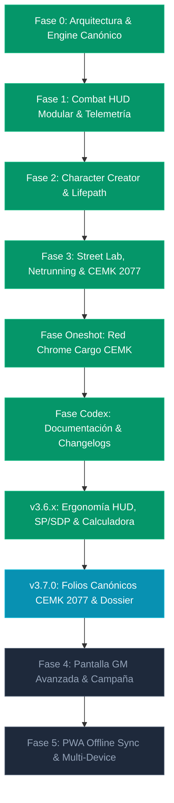

# CPR OMNI-DECK // Project Status & Master Development Roadmap

> **ESTADO DEL PROYECTO**: Versión Activa **`v3.7.0 OPERATIVO`**  
> **FECHA DE CORTE**: 2026-10-18  
> **ARQUITECTURA**: React 19 + TypeScript 5.8 + Vite + Tailwind CSS v4 + Zustand 5  
> **ALINEACIÓN**: Reglas oficiales Cyberpunk RED Core Rulebook + CEMK 2077 + Interface RED Vol. 1-4 + Danger Gal Dossier.

---

## 📊 1. Resumen Ejecutivo de Estado (v3.7.0)

CPR Omni-Deck es una plataforma táctica digital offline-first de alta fidelidad diseñada según la filosofía de arquitectura desacoplada COMP/CON de Lancer RPG. La aplicación actúa como un HUD de combate dinámico, un laboratorio de ciberware/equipo callejero, un asistente de Netrunning y un portal integral de gestión para Árbitros y Edgerunners de Cyberpunk RED.

### Métricas de Desarrollo en Vivo:
* **Ítems del Catálogo Multi-Libro**: 391+ ítems oficiales indexados sin pérdidas.
* **Folios Canónicos CEMK 2077**: 7 personajes oficiales pregenerados (28 páginas CEMK), 66 habilidades completas por folio con desglose `LVL + STAT = BASE`, y 7 tokens PNG oficiales.
* **Módulos de Sistema Principales**: 8 sistemas completamente integrados y operativos.
* **Enemigos y Facciones GM**: 44 perfiles base + 15 facciones oficiales (118 PNJs de Danger Gal Dossier).
* **Disciplinas Marciales y Movimientos**: 23 artes marciales y 46 movimientos especiales (Interface RED Vol. 4).
* **Chasis e Implantes de Conversión Total (FBC)**: 13 cuerpos FBC y 16 ciberwares de cuerpo completo (*Going Metal*).
* **Módulos de Ergonomía Táctica**: Matriz de Blindaje SP/SDP, Calculadora Táctica de Daño en tiempo real y Workspace reconfigurable en 3, 4 o 5 columnas.

---

## 🛠️ 2. Módulos del Sistema Operativos (v3.7.0)

| # | Módulo | Componente Principal | Estado | Descripción Funcional |
|---|--------|----------------------|:------:|-----------------------|
| 1 | **Motor de Combate & HUD Táctico** | `CombatHudView.tsx` | **100% OPERATIVO** | Grid modular reordenable en 3 zonas (Bio/Defensas, Centro configurable, Bandeja lateral), tiradas D10 con explosiones/pifias, DVs automáticos por distancia y tabla de armas, selector de ancho de columna (3, 4, 5 cols). |
| 2 | **Matriz Visual SP/SDP & Calculadora** | `CombatHudView.tsx` | **100% OPERATIVO** | Placas interactivas (`🛡️/💥`) para Cabeza y Torso, monitor SDP de Coberturas/Escudos (`🔰/💥`), Calculadora de Impactos con soporte para AP, Melee, Artes Marciales, Brawling y Críticos, y guía oficial integrada (pp. 183-187). |
| 3 | **Creador de Personajes & Lifepath** | `CharacterCreatorWizard.tsx` | **100% OPERATIVO** | Wizard de 6 pasos (Concepto/Rol, STATs por 3 métodos, Habilidades, Lifepath con tiradas 1d10, Equipo inicial por Rol y Exportación en formato oficial). |
| 4 | **Street Lab, Dojo & Inventario** | `StreetLabView.tsx` | **100% OPERATIVO** | Gestión de Eurodólares, inventario, instalación de ciberware con pérdida de Humanidad, zócalo neural con Chipware, Dojo de Artes Marciales (IP), y acordeón de Dossier Canónico CEMK 2077 (4 páginas: 66 skills, rol, arsenal y bio). |
| 5 | **Netrunning & 10 Habilidades de Rol** | `NetAndRolesDeckView.tsx` | **100% OPERATIVO** | Simulador de arquitectura de Red 2045 con programas Black ICE, consola de Quickhacking CEMK 2077 con cola de memoria RAM y terminal interactivo para las 10 Habilidades de Rol oficiales. |
| 6 | **Bestiario GM & Encuentros** | `EnemiesCompendiumPanel.tsx` | **100% OPERATIVO** | Catálogo de 44 enemigos base y 15 facciones con inyección directa de perfiles de combate en el HUD táctico y generador de goons al vuelo. |
| 7 | **Misión Oficial CEMK 2077 & Hub de Folios** | `RedChromeCargoView.tsx` | **100% OPERATIVO** | Misión interactiva *Red Chrome Cargo* con mapa Maglev Hammerhead, tablero de escenas, spawneo de enemigos, botín y pestaña 4 con selector dual de Edgerunners 2077 (7 Folios CEMK + 7 Anime Crew) con modal de 66 habilidades. |
| 8 | **Codex & Documentación Maestra** | `SystemChangelogAndDocsView.tsx` | **100% OPERATIVO** | Portal in-app de documentación, registro cronológico versión por versión (`v1.0.0` a `v3.7.0`), inventario de sistemas y contratos técnicos. |

---

## 🗺️ 3. Estado Detallado del Roadmap por Fases

### ✅ Fase 0: Arquitectura Base, Ingesta CLI & Contratos Canónicos (COMPLETADA)
* **Objetivo**: Establecer la base de datos tipada sin inventar reglas, extrayendo los 272 ítems del Core Rulebook mediante Python.
* **Entregables**: Archivo `data/core-rules.cprpack.json`, scripts de extracción de PDFs, esquema JSON canónico y contratos TypeScript.

### ✅ Fase 1: Combat HUD Modular & Telemetría de Combate (COMPLETADA)
* **Objetivo**: Pantalla de combate para uso directo en mesa con resolución de ataques en 2 clics.
* **Entregables**: `CombatHudView.tsx`, cálculo automático de DVs según metros de distancia, soporte para Autofire (2d6 × multiplicador), consumo de munición, heridas críticas y consola de telemetría.

### ✅ Fase 2: Creador de Personajes Completo & Lifepath (COMPLETADA)
* **Objetivo**: Diseñar y generar edgerunners siguiendo las reglas canónicas del Core Rulebook.
* **Entregables**: `CharacterCreatorWizard.tsx`, 10 roles oficiales, 3 métodos de STATs (Streetrats, Edgerunners, Complete Package), Lifepath interactivo y compra de equipo inicial.

### ✅ Fase 3: Street Lab, Netrunning & Expansiones Interface RED (COMPLETADA)
* **Objetivo**: Integrar las expansiones premium oficiales de R. Talsorian Games.
* **Entregables**: `StreetLabView.tsx`, `NetAndRolesDeckView.tsx`, 23 artes marciales de *Interface RED Vol. 4*, 13 cuerpos FBC de *Going Metal*, Quickhacking del *Cyberpunk 2077 CEMK* y 118 PNJs de *Danger Gal Dossier*.

### ✅ Fase Oneshot: Misión Red Chrome Cargo (COMPLETADA)
* **Objetivo**: Implementar la aventura interactiva introductoria para el Árbitro.
* **Entregables**: `RedChromeCargoView.tsx`, mapa Maglev Hammerhead SVG con zoom/pan, tracker de vagones, notas de Árbitro y encuentro final con la banda Iron Sights.

### ✅ Fase Codex: Portal Maestro de Documentación & Changelog In-App (COMPLETADA)
* **Objetivo**: Visor interactivo dentro de la app para auditar todo el sistema.
* **Entregables**: `SystemChangelogAndDocsView.tsx`, timeline interactiva de versiones, inventario de sistemas y contrato de stack técnico.

### ✅ Actualización v3.6.0 - v3.6.2: Ergonomía Táctica del HUD de Combate (COMPLETADA)
* **Objetivo**: Proporcionar control total sobre el espacio visual de combate y automatizar el cálculo de blindaje y coberturas.
* **Entregables**:
  - **Selector de ancho de columna de Bio/Defensas**: Configuración de 3, 4 o 5 columnas (`cpr_left_panels_size_v1`) con reajuste reactivo de la columna central (el grid de Tailwind siempre totaliza 12).
  - **Controles de altura en tarjetas del panel izquierdo**: Modos `[ S ]` (160px), `[ M ]` (280px), `[ L ]` (480px), `[ ↕ Todo ]` y botones `[-]` / `[+]`.
  - **Grip de redimensionamiento vertical (`Resize Grip 📏`)**: Arrastre libre con ratón en la parte inferior de cada panel para ajuste fino de altura.
  - **Auto-expansión inteligente**: Detección automática cuando hay más de 3 heridas críticas, ciberware instalado o fármacos activos, expandiendo la tarjeta y mostrando la insignia `🔓 Auto-expandido ({count})`.
  - **Placas de Blindaje Visuales**: Insignias interactivas (`🛡️` intacta vs `💥` ablacionada) con click directo para fijar SP en Cabeza y Torso (hasta 20 placas).
  - **Monitor SDP de Escudos & Coberturas**: Rastreador de Puntos de Daño Estructural con presets oficiales (Escudo Antibalas 10 SDP, Madera 15 SDP, Metal 25 SDP, Acero 35 SDP).
  - **Calculadora Táctica de Daño en Tiempo Real**: Soporte completo para munición estándar (-1 SP), perforante AP (-2 SP), armas melee (50% SP), artes marciales (50% SP), brawling (100% SP) y daño directo (0% SP), cálculo de multiplicador de cabeza (×2) y críticos (+5 HP).
  - **Acordeón Oficial de Reglas CP RED**: Guía integrada con citas exactas del manual Core pp. 183-187.

### ⏳ Fase 4: Pantalla del Árbitro (GM Master Screen) & Tracker de Campaña (EN ROADMAP)
* **Objetivo**: Dotar al Árbitro de herramientas para coordinar iniciativas grupales, seguimiento de campaña y estado del equipo.
* **Módulos proyectados**:
  - Tracker de Iniciativa de Combate multi-participante con integración al Bestiario y al edgerunner activo.
  - Generador procedural de encuentros callejeros según el nivel de peligro de Night City.
  - Gestor de reputación con Corporaciones y Facciones (Arasaka, Militech, Trauma Team, Maelstrom, etc.).
  - Registro de deuda, renta mensual y estilo de vida de los PJs (Core Rulebook pg. 377).

### ⏳ Fase 5: Modo PWA Offline Sync & Conexión Local Multi-Dispositivo (EN ROADMAP)
* **Objetivo**: Permitir juego en mesa con múltiples dispositivos sincronizados localmente vía WebRTC/WebSockets sin requerir conexión a internet.
* **Módulos proyectados**:
  - Service Worker PWA con almacenamiento cacheado de todos los recursos gráficos y JSONs canónicos.
  - Sala local peer-to-peer para que el GM reciba las tiradas del jugador en tiempo real en su pantalla.
  - Exportación e importación de estado completo de partida en archivo `.cprsave.json`.

---

## 🔒 4. Matriz de Cumplimiento de Contratos Técnicos

* **Cero Desviación de Reglas**: Todas las mecánicas (DVs, tablas de rango, ablación, críticos, STATs) replican estrictamente los manuales impresos de R. Talsorian Games.
* **Arquitectura Offline-First**: Toda la información y estados se persisten en `localStorage` del navegador y en los catálogos JSON/TS empaquetados en el bundle, permitiendo ejecución en búnker sin conexión.
* **Integridad del Bundle**: 0 errores de TypeScript (`tsc -b --noEmit`) y 0 advertencias críticas en el empaquetado de producción (`npm run build`).
